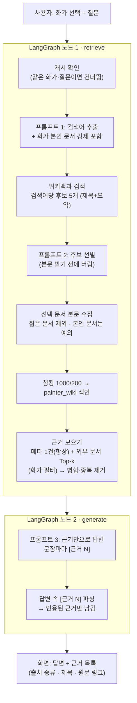
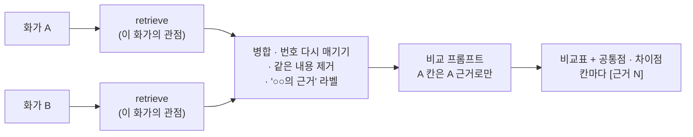
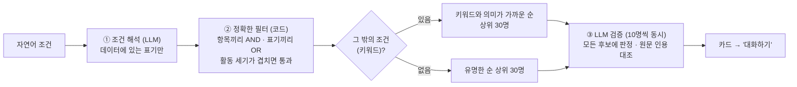

# RAG 파이프라인 설계문서 — 화가 도슨트

> SSAFY AI 코어 프로젝트 2회차 · 도메인: **화가** · 작성일 2026-10-22
>
> 한국어 위키백과에 문서가 있는 화가 1,343명을 대상으로, 사용자가 화가를 골라 질문하면 **수집한 문서만 근거로** 답하고 근거를 함께 보여주는 서비스다.

## 목차

0. [전체 구조](#0-전체-구조)
1. [Vector DB 컬렉션 구조와 메타데이터](#1-vector-db-컬렉션-구조와-메타데이터)
2. [문서 수집 · 청킹 · 색인 흐름](#2-문서-수집--청킹--색인-흐름)
3. [검색 결과 병합과 중복 제거](#3-검색-결과-병합과-중복-제거)
4. [프롬프트 설계](#4-프롬프트-설계)
5. [청크 크기 · 중복 길이 · Top-k 설정과 변경 실험](#5-청크-크기--중복-길이--top-k-설정과-변경-실험)
6. [답변의 근거 표시 방식](#6-답변의-근거-표시-방식)
7. [도메인 특화 기능: 화가 비교](#7-도메인-특화-기능-화가-비교)
8. [조건 기반 화가 탐색](#8-조건-기반-화가-탐색)
9. [설계 선택의 이유와 겪은 문제 · 해결 과정](#9-설계-선택의-이유와-겪은-문제--해결-과정)
10. [심화 기능 요약](#10-심화-기능-요약)
11. [알려진 한계와 개선 방향](#11-알려진-한계와-개선-방향)

---

## 0. 전체 구조

### 0.1 기술 구성

| 구분 | 사용 기술 |
|---|---|
| 언어 · 실행 | Python 3.12 |
| RAG | LangChain 1.3.14, LangGraph 1.2.10, langchain-openai 1.4.3, langchain-chroma 1.1.0 |
| Vector DB | ChromaDB 1.5.9 (로컬 저장 `chroma_db/`) |
| 모델 (SSAFY GMS 경유) | 임베딩 `text-embedding-3-small` · 검색어 추출/후보 선별 `gpt-4o-mini` · 답변/비교/조건 탐색 `gpt-4.1-mini` |
| 화면 | Streamlit 1.62 (필수) + FastAPI 0.141.1 · HTML/CSS/JS (심화 F2013) |
| 데이터 출처 | Wikidata (CC0 1.0), 한국어 위키백과 (CC BY-SA 4.0), 국립현대미술관 소장작품 API (문화데이터광장) |

### 0.2 모듈 구조 (NF2005)

수집 · 색인 · 검색 · 생성 · UI의 책임을 폴더로 나누었고, 화가 도메인에 묶인 코드는 `data_prep/`에 모았다.

| 영역 | 파일 | 하는 일 |
|---|---|---|
| 데이터 준비 (도메인) | `collect_painters.py`, `data_prep/painters.py`, `data_prep/images.py` | 위키데이터 수집, 화가 1명 → 색인 텍스트, 작품 이미지 정보 |
| 외부 문서 수집 | `collector/query_extractor.py`, `collector/collect_docs.py`, `collector/wikipedia.py`, `collector/mmca.py` | 프롬프트 1·2, 위키백과/국립현대미술관 API 호출, 수집 캐시 |
| Vector Store (도메인 무관) | `vectorstore/store.py`, `index_meta.py`, `index_wiki.py`, `index_mmca.py` | 컬렉션 생성·조회·삭제, 청킹, 임베딩 색인 |
| RAG 파이프라인 | `rag/graph.py`, `rag/prompts.py`, `rag/search_compare.py` | LangGraph `retrieve → generate`, 프롬프트, 근거 번호 |
| 서비스 기능 | `services/compare.py`, `services/painter_search.py` | 화가 비교(F2010), 조건 기반 탐색(F2011) |
| UI | `app.py` (Streamlit), `api/` + `web/` (FastAPI + HTML/CSS/JS) | 화가 선택, 채팅, 진행 상태·오류 안내 |
| 설정 | `config.py`, `.env` | 모든 조정 값, API 키(환경변수로만) |

### 0.3 질문 하나가 처리되는 흐름



---

## 1. Vector DB 컬렉션 구조와 메타데이터

화가 정보와 외부 문서는 성격이 달라서 **컬렉션 두 개**로 나누었다. 현재 색인 건수는 `painter_meta` 1,343개, `painter_wiki` 642개(위키백과 595 + 국립현대미술관 47)다.

### 1.1 `painter_meta` — 화가 메타데이터 (화가 1명 = 청크 1개)

- **청크 ID = 위키데이터 ID** (예: `Q296` 모네). 같은 화가는 몇 번을 다시 색인해도 덮어쓰기만 일어난다.
- **색인 텍스트** (F2001): `항목: 값` 줄로 구성하고 빈 값은 줄째로 뺀다. 빈 줄이 많으면 화가끼리 텍스트가 비슷해져 검색이 흐려지기 때문이다.

  ```text
  이름: 클로드 모네 (Claude Monet)
  소개: 프랑스의 화가
  국적: 프랑스
  대륙: 유럽
  생애: 1840년 ~ 1926년
  활동 시기: 19~20세기          ← 출생·사망 연도를 세기로 바꿔 넣음 ("19세기 화가" 검색 대비)
  출생지: 파리
  사조: 인상주의
  장르: 초상, 정물화, 풍경화
  대표작: 인상, 해돋이, 생타드레스의 정원, 건초더미, 루앙 대성당, …
  ```

| 메타데이터 필드 | 용도 |
|---|---|
| `painter_id`, `name` | 화가 식별, 표시 |
| `rank` | 유명도 순위 (위키 sitelinks 수) — 목록·조건 탐색 정렬 |
| `birth_year`, `death_year`, `continents` | 표시·필터 보조 |
| `source_type` = "화가 메타데이터" | 근거의 출처 종류 구분 (F2007) |
| `title`, `source_url`, `wiki_title`, `wiki_url` | 근거 제목과 원문 출처 (Wikidata 항목, 한국어 위키백과 문서) |

ChromaDB 메타데이터는 글자·숫자·참거짓만 담을 수 있어서, 목록 값(사조 여러 개 등)은 쉼표로 이어 붙이거나 텍스트 쪽에 둔다.

### 1.2 `painter_wiki` — 외부 문서 청크 (위키백과 + 국립현대미술관)

- **청크 ID = `화가ID:문서ID:순번`** (예: `Q296:3763996:0`). 여러 화가가 같은 문서(예: "인상주의")를 수집해도 화가 ID가 달라서 서로 덮어쓰지 않는다. 실제로 같은 "수련 (모네)" 문서를 두 화가 몫으로 넣었을 때 `Q296:3763996:*`와 `TEST:3763996:*`가 따로 저장되는 것을 확인했다.
- **청크 텍스트**: 첫 줄에 `[문서 제목]`을 붙인다. 청크만 봐도 어느 문서의 내용인지 알 수 있어야 검색과 답변이 정확해진다.

| 메타데이터 필드 | 용도 |
|---|---|
| `painter_id`, `painter_name` | **검색 범위를 그 화가로 좁히는 필터** (없으면 다른 화가 문서가 섞임 — 9장 문제 8) |
| `page_id`, `title`, `source_url` | 문서 식별, 근거 제목, 원문 출처 |
| `source_type` | "위키백과" / "국립현대미술관 소장품" — 근거에 출처 종류 표시 (F2016) |
| `query`, `collected_at` | 어떤 검색어로 언제 수집했는지 (출처 기록, NF2007) |
| `chunk_index`, `chunk_total` | 순번, 문서의 전체 청크 수 |
| `chunk_size`, `chunk_overlap` | 이 설정으로 잘랐다는 기록 → 설정이 바뀌면 그 문서만 다시 색인 |
| `chunking` (국립현대미술관만) | "작품 1점 = 청크 1개" 등 청킹 방식 기록 |

### 1.3 왜 컬렉션을 둘로 나눴나

1. **검색 방식이 다르다.** 화가 메타데이터는 질문과 상관없이 **ID로 바로 꺼내 항상 근거 1번**에 넣고, 외부 문서는 **질문과의 의미 유사도로 검색**한다. 한 컬렉션에 섞으면 메타데이터 청크가 유사도 경쟁에서 밀리거나, 반대로 짧은 메타데이터가 문서 청크를 밀어낸다.
2. **수명과 크기가 다르다.** 메타데이터는 1,343개로 고정이고, 외부 문서는 질문할 때마다 늘어난다. 한쪽을 다시 색인(`--reset`)해도 다른 쪽에 영향이 없다.
3. **조건 기반 탐색(F2011)** 은 메타데이터 컬렉션만 대상으로 후보를 찾는다.

---

## 2. 문서 수집 · 청킹 · 색인 흐름

### 2.1 화가 메타데이터 (F2001 ~ F2002)

1. **수집** (`collect_painters.py`): 위키데이터 SPARQL로 "사람 + 직업이 화가 + 한국어 위키백과 문서 있음" → 2,054명.
2. **비화가 거르기**: 위키데이터 직업에는 부업도 들어가서 배우·가수가 섞인다. 한국어 소개에 '화가'(만화가 제외) / 영어 소개에 'painter' / 사조 정보 중 하나라도 있어야 화가로 인정 → **1,343명 유지, 711명 제외**. 제외 목록을 직접 검수한 결과 실제 화가는 8명(1.1%)이었다.
3. **상세 정보**: 출생·사망, 국적, 사조, 장르, 대표작 등을 30명씩 나눠 조회. 유명한 순(sitelinks)으로 정렬해 `rank`를 붙인다.
4. **색인** (`index_meta.py`): 1.1의 텍스트로 임베딩해 `painter_meta`에 upsert. **두 번 실행해도 1,343개 그대로**인 것을 확인했다.

### 2.2 위키백과 문서 (F2003 ~ F2005) — 질문이 들어올 때마다

| 순서 | 단계 | 내용 |
|---|---|---|
| 1 | 캐시 확인 (NF2002) | `data/collect_cache.json`에 "화가+질문"이 있으면 저장된 검색어를 그대로 쓰고, "화가+검색어"가 있으면 그 검색어는 다시 수집하지 않는다 |
| 2 | 검색어 추출 (프롬프트 1) | 화가 색인 텍스트 + 질문 → JSON 배열. **화가 본인 문서 제목은 코드가 맨 앞에 강제로 넣는다** |
| 3 | 화가 본인 문서 | 선별·길이 규칙을 건너뛰고 **무조건 수집** (F2004 규칙) |
| 4 | 후보 검색 | 나머지 검색어마다 위키백과 검색 → 후보 5개의 **제목과 앞부분 요약(300자)만** 받는다 |
| 5 | 후보 선별 (프롬프트 2) | 제목·요약만 보고 고른 문서만 본문을 받는다. 본문을 받기 전에 버려서 외부 호출을 줄인다 |
| 6 | 본문 수집 | `data/wiki_docs/{문서ID}.json`에 본문 · URL · 관련 화가 · 수집일 저장. 300자 미만 문서는 버림 |
| 7 | 정리 · 청킹 | 본문 끝의 "각주 · 같이 보기 · 외부 링크" 이후를 잘라내고, 문단 → 줄 → 문장 → 띄어쓰기 순으로 경계를 찾아 **1,000자 / 200자 중복**으로 나눈다 |
| 8 | 색인 | 그 화가·문서의 옛 청크를 먼저 지우고 새로 넣는다. 같은 설정으로 이미 색인돼 있으면 건너뛴다 |

위키미디어 API 예절(NF2006): User-Agent에 연락처, 요청 간격 1초, 429·5xx는 최대 3회 재시도, 긴 요청은 POST로 보낸다.

**수집 예시** — 피카소 · "게르니카는 어떤 사건을 그린 거야?"

| 검색어 (프롬프트 1) | 후보 | 색인한 문서 (프롬프트 2) | 버린 문서 |
|---|---|---|---|
| 파블로 피카소 | (본인 문서) | 파블로 피카소 | — |
| 게르니카 | 5개 | 게르니카 (피카소), 게르니카 폭격 | 게르니카(지명), 게르니카 (동음이의) … |
| 스페인 내전 | 5개 | 스페인 내전 | 스페인, 국민파, 프란시스코 프랑코, 프랑코 정권 |

같은 질문을 다시 하면 프롬프트 1 · 위키백과 · 프롬프트 2를 하나도 부르지 않는다.

### 2.3 국립현대미술관 소장작품 (F2016) — 한 번에

1. **수집** (`index_mmca.py`): 문화데이터광장 API에서 전체 112건을 받는다. 이 API는 검색어를 무시하고, 작가 필드에는 '누리집'만 들어 있어서 **상세 페이지 주소의 `artistnm` 값**에서 작가명을 꺼낸다. 같은 작품이 두 번 등록된 4건은 먼저 등록된 것만 남긴다 → 108건.
2. **화가 연결**: 작가 이름이 우리 화가와 같고, **작품 설명에 그 화가의 출생 연도가 나올 때만** 연결한다 (동명이인 방지). → 8명, 45작품.
3. **청킹**: **작품 1점 = 청크 1개** (1,500자를 넘는 1건만 위키와 같은 규칙으로 분할) → 47개.
4. **색인**: `painter_wiki`에 `source_type = "국립현대미술관 소장품"`으로 함께 넣는다. 화가 필터로 위키백과 청크와 같이 검색된다.

### 2.4 출처별로 수집 · 청킹을 다르게 한 이유 (F2016)

| | 위키백과 | 국립현대미술관 소장품 |
|---|---|---|
| 문서 하나의 성격 | 화가·사건 전체를 다룬 긴 글 (수천~수만 자), 주제가 여러 개 | 작품 1점에 대한 완결된 설명 (중앙값 544자) |
| 수집 | 질문마다 검색어 → 후보 선별 → 본문 | API가 검색어를 무시 → 전체를 한 번에 |
| 청킹 | 1,000자 / 200자 중복으로 잘게 | 작품 1점 = 청크 1개 |
| 이유 | 긴 글에서 질문과 맞는 부분만 골라야 근거가 정확해진다 | 자르면 "어떤 작품 이야기인지"가 잘려 나가 근거가 애매해진다 |

---

## 3. 검색 결과 병합과 중복 제거

`rag/graph.py`의 `retrieve` 노드가 근거 목록을 만든다.

1. **화가 메타데이터 1건**: 검색 없이 ID로 꺼내 **항상 `[근거 1]`** 에 넣는다. 질문이 무엇이든 국적·생애·사조 같은 기본 정보는 근거로 쓸 수 있어야 하기 때문이다 (F2006 규칙).
2. **외부 문서 청크 Top-k**: `painter_wiki`에서 `painter_id`로 범위를 좁힌 뒤 질문과의 유사도로 `WIKI_TOP_K`(5)개를 가져온다. 위키백과와 국립현대미술관 청크가 같은 기준으로 경쟁한다.
3. **병합 · 중복 제거**: 순서대로 합치면서 ① **같은 청크 ID** ② **공백을 뺀 내용이 완전히 같은 청크**는 한 번만 넣는다. (여러 화가가 같은 문서를 수집하면 청크 ID는 달라도 내용이 같기 때문)
4. **번호 매기기**: 남은 근거에 1부터 번호를 붙이고, 출처 종류(화가 메타데이터 / 위키백과 / 국립현대미술관 소장품)를 함께 둔다.

**화가 비교(F2010)** 에서는 화가 A, B 각각 위 과정을 거친 뒤 두 목록을 이어 붙이며 다시 번호를 매긴다. 이때도 내용이 같은 청크는 한 번만 넣고, 근거마다 **"○○의 근거"** 라벨을 붙인다.

---

## 4. 프롬프트 설계

모든 프롬프트는 `rag/prompts.py` 한 곳에 모았다. 결과를 코드가 읽어야 하는 프롬프트는 **JSON만 출력**하게 하고, 코드가 배열·객체 부분만 꺼내 읽는다 (LLM이 ```json으로 감싸거나 말을 덧붙여도 동작).

### 4.1 RAG 프롬프트 3개

| | 프롬프트 1 · 검색어 추출 | 프롬프트 2 · 후보 선별 | 프롬프트 3 · 답변 생성 |
|---|---|---|---|
| 요구사항 | F2003 | F2004 | F2007 · F2008 |
| 역할 | 20년 경력 미술사 큐레이터 | 미술사 큐레이터 | 미술관 도슨트 |
| 입력 | 화가 색인 텍스트 + 질문 | 화가 이름 + 질문 + 후보(번호·제목·요약) | 번호 붙은 근거(출처 종류 포함) + 질문 |
| 출력 | JSON 문자열 배열 `["게르니카", "스페인 내전"]` | JSON 정수 배열 `[2, 5]` | 문장마다 `[근거 N]`이 붙은 한국어 답변 |
| 모델 | gpt-4o-mini | gpt-4o-mini | gpt-4.1-mini |

**프롬프트 1의 핵심 규칙**
- 화가 본인 문서는 이미 포함되므로 화가 이름만 단독으로 쓰지 않는다. (본인 문서는 **코드가 강제로** 맨 앞에 넣는다 — LLM이 깜빡해도 규칙이 깨지지 않게)
- 위키백과 문서 제목처럼 짧은 명사로, 최대 5개, 중요한 순서대로.
- "20세기", "회화"처럼 넓은 검색어와 질문이 묻지 않은 사조는 넣지 않는다. 대신 **시대 배경·사건을 물으면 구체적인 사건 이름**(예: "스페인 내전")은 꼭 넣는다.
- 본인 문서만으로 충분하면 빈 배열 `[]`. ("언제 태어났어?" → 추가 수집 없음)

**프롬프트 2의 핵심 규칙**
- 질문 속 화가·작품·사건과 직접 관련된 문서만. 이름만 같은 문서(꽃 '수련', 동명이인)는 버린다.
- 사건을 묻는 질문이면 그 사건의 대표 문서는 고르고, 개별 인물·부대 문서는 버린다.
- 확신이 없으면 버린다 (엉뚱한 문서를 섞는 것보다 적게 고르는 게 낫다).
- **왜 따로 두었나**: 후보 단계에서 제목·요약만 보고 버리면, 본문 요청을 크게 줄일 수 있다. 모네 · 수련 질문에서 후보 15개 중 본문을 받은 문서는 "수련 (모네)" 1개였다 (화가 본인 문서는 후보와 별도로 항상 수집).

**프롬프트 3의 핵심 규칙**
- `[근거]`에 적힌 내용만 사용하고, 원래 알던 지식으로 보태거나 추측하지 않는다.
- 사실을 말할 때마다 문장 끝에 근거 번호. 근거가 여러 개면 `[근거 1][근거 3]`.
- 답이 근거에 없으면 **"제공된 문서에서는 확인되지 않습니다."** 일부만 확인되면 확인된 부분만 답하고 나머지는 확인되지 않는다고 밝힌다.
- 모든 근거를 끝까지 읽고 질문에 직접 답하는 내용(숫자·장소·이름)은 빠뜨리지 않는다.

### 4.2 서비스 기능용 프롬프트 3개

| 프롬프트 | 역할 · 입력 | 출력 | 핵심 장치 |
|---|---|---|---|
| 조건 해석 (F2011) | 자연어 조건 + **데이터에 실제로 있는 표기 목록**(국적 164 · 사조 247 · 장르 214종) | JSON 객체 `{nationality, continents, movements, genres, century_from, century_to, keywords}` | 목록에 없는 표기는 코드가 버린다. 왕조명은 일반 표기 + 세기로 ("조선 시대" → 국적 [조선, 한국] + 14~19세기) |
| 조건 검증 (F2011) | 조건 + 후보 화가 색인 텍스트 (10명씩) | 모든 후보에 `{no, match, reason, quote}` | 정보 칸에 없는 조건은 **원문 인용(quote)** 을 받아 **코드가 원문에 실제로 있는지 대조** |
| 화가 비교 (F2010) | 두 화가 + 비교 관점 + 화가 라벨이 붙은 근거 | 마크다운 비교표 + 공통점 · 차이점, 칸마다 `[근거 N]` | "A의 칸은 A의 근거로만", 근거에 없으면 "확인되지 않음" |

---

## 5. 청크 크기 · 중복 길이 · Top-k 설정과 변경 실험

모든 값은 코드가 아니라 `config.py`에서 바꾼다 (F2005).

### 5.1 정한 값과 이유

| 설정 | 값 | 이유 |
|---|---|---|
| `CHUNK_SIZE` | 1,000자 | 한국어 위키백과의 한 소절(예: "== 역사 ==" 아래 문단 2~3개)이 들어가는 크기. 이보다 작으면 "수련 연작 250점"과 "주요 소장처"처럼 이어진 사실이 다른 청크로 갈라지고, 크면 한 청크에 여러 주제가 섞여 유사도가 흐려진다 |
| `CHUNK_OVERLAP` | 200자 | 문장이 청크 경계에서 잘려도 앞뒤 맥락이 남도록. 크기의 20% |
| `WIKI_TOP_K` | 5 (+ 메타데이터 1 = 근거 6개) | 질문 하나의 답이 보통 1~3개 청크에 있어서 여유를 두고 5개. 더 늘려도 답이 좋아지지 않고 프롬프트만 길어졌다 (5.3) |
| `SEARCH_TYPE` | similarity | MMR과 비교 실험 결과 (5.4) |
| `COMPARE_TOP_K` | 화가당 4 | 비교는 두 화가 몫이라 총 근거 수를 10개 안쪽으로 |

### 5.2 청크 크기를 바꿨을 때

| 설정 | 문서 10개의 청크 수 |
|---|---|
| 1,000자 / 200자 (기본) | 240개 |
| 500자 / 100자 | **505개** |
| 다시 1,000자 / 200자 | **240개** (옛 청크가 남지 않고 정확히 돌아옴) |

청크를 작게 하면 개수가 두 배 이상 늘어 임베딩 비용이 커지고, 한 사실이 여러 청크에 흩어진다.

### 5.3 Top-k를 바꿨을 때 (모네 · "수련 연작은 몇 점이고 어디 있어?")

| Top-k | 근거 수 (메타 포함) | 답변 |
|---|---|---|
| 3 | 4 | 약 250점, 주요 소장처 — 오랑주리 미술관 언급 없음 |
| 5 | 6 | 같음 |
| 10 | 11 | 같음 |

오랑주리 정보는 Top-k 3에서도 이미 `[근거 2]` 안에 있었다. 즉 **검색이 아니라 생성 단계에서 빠뜨린 문제**였고, Top-k를 늘려서는 해결되지 않았다 → 프롬프트 3에 "질문에 답하는 내용은 빠뜨리지 마" 규칙과 답변 모델 교체로 해결 (9장 문제 9, 10).

### 5.4 유사도 검색 vs MMR (F2014, 후보 20개 → 5개, λ = 0.5)

| 질문 | 근거 문서 수 | 한 문서 최대 점유 | 근거끼리 평균 유사도 | 답변의 핵심 사실 |
|---|---|---|---|---|
| 모네 · 수련 연작 | 2 → 5 | 3 → 1 | 0.604 → 0.330 | 4/4 → **3/4** (오랑주리 빠짐) |
| 피카소 · 게르니카 | 2 → 4 | 3 → 2 | 0.446 → 0.280 | 4/4 → **2/4** |
| 다 빈치 · 모나리자 | 1 → 3 | 5 → 2 | 0.586 → 0.344 | 1/2 → 1/2 |
| 이중섭 · 시대 배경 | 2 → 2 | 4 → 4 | 0.491 → 0.376 | 비슷함 |
| 클림트 · 키스 | 2 → 2 | 4 → 3 | 0.561 → 0.442 | 4/4 → 4/4 |

MMR은 다섯 질문 모두 근거를 다양하게 만들었지만, 정답이 **한 문서의 이웃 청크에 몰려 있는 사실형 질문**에서는 정답 청크를 "중복"으로 보고 빼 버렸다. 우리 서비스의 질문은 대부분 사실형이라 **기본값은 유사도 검색**으로 두고, MMR은 화면에서 고를 수 있는 옵션으로 두었다. λ는 0.7(다양성 효과 약함)과 0.3(0.5와 거의 같음) 사이에서 0.5를 골랐다.

---

## 6. 답변의 근거 표시 방식

1. **번호 부여**: retrieve가 근거마다 번호를 붙여 `[근거 N] (출처 종류) 제목 + 본문` 형식으로 프롬프트 3에 넣는다.
2. **답변 속 표기**: 프롬프트 3이 사실마다 `[근거 N]`을 붙인다.
3. **인용 파싱**: 정규식으로 `[근거 3]`, `[근거 1, 2]`, `[근거1][근거2]`를 모두 찾아 번호 목록을 만든다. **없는 번호(LLM이 지어낸 번호)는 무시**한다.
4. **인용된 근거만 표시** (F2008): 검색된 근거 6개 중 실제로 인용된 것만 "이 답변의 근거"에 **번호 · 출처 종류 · 제목(원문 링크)** 으로 보여준다. 인용 안 된 것을 포함한 전체 근거는 접힌 칸에 둔다(검증용).
5. **인용이 하나도 없으면** "이 답변에는 인용된 근거가 없어요. 수집된 문서에서 확인된 내용이 없다는 뜻이에요."를 표시한다.
6. **출처 종류 구분**: 📇 화가 메타데이터 · 📖 위키백과 · 🏛️ 국립현대미술관 소장품 (F2007, F2016). 화가 비교에서는 "○○의 근거"를 덧붙인다.

| 예 | 답변 | 표시되는 근거 |
|---|---|---|
| 모네 · 수련 | "…약 250점 정도가 남아 있어요 `[근거 3]`… 오랑주리 미술관에 수련 벽화 8점이 상설 전시되고 있답니다 `[근거 2]`" | 📖 수련 (모네) — 2개 |
| 피카소 · 좋아한 음식 | "제공된 문서에서는 확인되지 않습니다." | 인용 없음 안내 |
| 이중섭 · 말년 | 위키백과와 국립현대미술관 내용을 함께 인용 | 📖 이중섭 · 🏛️ 세 사람 · 🏛️ 소년 |

웹 화면(F2013)에서는 `[근거 N]`을 골드 번호 배지로 바꾼다. LLM이 쓴 글은 HTML로 해석되지 않게 글자로만 넣고, 비교표 마크다운은 DOMPurify로 정리한 뒤 넣는다.

---

## 7. 도메인 특화 기능: 화가 비교

### 7.1 왜 이 기능인가

- 미술관에서 관람객이 가장 많이 하는 질문 중 하나가 **"이 화가랑 저 화가는 뭐가 달라요?"** 다. 같은 사조·같은 시대 화가를 나란히 보면 각자의 특징이 더 잘 드러난다 (김홍도와 신윤복, 모네와 고흐).
- 이미 만든 **화가별 수집 · 색인 · 검색 부품을 두 번 재사용**할 수 있어서, 비교 결과도 자연스럽게 화가별로 분리된 근거를 갖는다. 새 데이터 없이 RAG 파이프라인 위에 "기능"을 얹는 구조다.
- 비교는 LLM이 원래 아는 지식으로 그럴듯하게 지어내기 쉬운 작업이라, **근거 기반이 특히 중요**하다.

### 7.2 설계



- 비교 관점은 사용자가 정한다 (비우면 "생애, 사조, 대표작, 화풍").
- 화가별 검색 질문은 **"{이 화가}의 {관점}"** 이다. 상대 화가 이름은 넣지 않는다 (9장 문제 17).
- 근거에 없는 칸은 "확인되지 않음"으로 남긴다.

### 7.3 결과

| 비교 | 결과 |
|---|---|
| 김홍도 vs 신윤복 · "풍속화의 소재와 분위기" | 서민 일상·익살 vs 남녀·기녀·세련됨, 배경 생략 vs 배경 묘사. 근거 [1~5] 김홍도 문서, [6~9] 신윤복 문서로 분리 |
| 모네 vs 고흐 · 기본 관점 | 비교 항목 4개(생애·사조·대표작·화풍), 근거 배지 33개, 화가별 근거 구분 |
| 다 빈치 vs 미켈란젤로 | 근거로 확인 안 되는 "예술 외 업적" 칸은 "확인되지 않음" |

---

## 8. 조건 기반 화가 탐색

"19세기 프랑스 인상주의 풍경화가"처럼 자연어 조건으로 화가를 찾는다 (F2011).



**왜 벡터 검색만 쓰지 않았나**: 처음 메타데이터 컬렉션에 "인상주의 풍경화가"로 유사도 검색만 했더니, 정보가 거의 없는 명나라 화가가 1위(유사도 0.347)였고 모네는 0.154였다. 짧고 빈약한 텍스트가 짧은 질의와 오히려 닮아 보이는 문제다. 그래서 **정확한 조건은 필터로, 애매한 조건은 벡터와 LLM으로** 나누었다.

| 조건 | 해석 | 필터 → 후보 → 결과 |
|---|---|---|
| 19세기 프랑스 인상주의 풍경화가 | 국적 프랑스 · 사조 인상주의 · 장르 풍경화 · 19세기 | 12 → 12 → 12명 |
| 이탈리아 르네상스 화가 | 이탈리아 옛 나라들 · 르네상스 계열 | 30 → 30 → 28명 |
| 조선 시대 화가 | 국적 조선 · 한국 · 14~19세기 | 49 → 30 → 29명 (김홍도·신윤복·장승업 포함) |
| 현대 한국 화가 | 국적 대한민국 · 한국 · 20~21세기 | 147 → 30 → 28명 |
| 조선 시대 풍속화가 | + 장르 풍속화 | **0명** + "조선 화가 48명 중 45명은 장르 정보가 비어 있어요" |
| 빛을 잘 표현한 네덜란드 화가 | 국적 네덜란드 계열 · 기타 "빛을 잘 표현한" | 60 → 30 → **0명** + "정보에서 확인할 수 없는 조건" 안내 |

결과가 0명일 때는 지어내지 않고 **왜 0명인지**를 알려준다.

**화가 이름 입력**: 조건 해석에 앞서, 입력이 화가 이름(의 일부)인지 먼저 확인한다 (띄어쓰기·괄호 설명 무시, 영문 이름 포함). 이름이면 LLM 없이 바로 유명한 순으로 보여준다 ("모네" → 클로드 모네, 시모네 마르티니 …). 처음에는 "레오나르도 다 빈치"를 조건으로 해석해 '기타' 조건이 되면서 0명이 나왔다 (9장 문제 28).

---

## 9. 설계 선택의 이유와 겪은 문제 · 해결 과정

### 9.1 선택의 이유 요약

| 선택 | 이유 |
|---|---|
| 컬렉션 2개 분리 | 1.3 참고 — 검색 방식·수명·용도가 다름 |
| 청크 ID `화가ID:문서ID:순번` | 같은 문서를 여러 화가가 수집해도 덮어쓰지 않고, 화가 필터로 범위를 좁힐 수 있음 |
| 1,000/200 청킹 + 제목 머리글 | 한 소절이 들어가는 크기, 청크만 봐도 출처를 알 수 있게 |
| 출처별 다른 청킹 | 2.4 참고 — 미술관 설명은 작품 1점이 하나의 완결된 글 |
| 프롬프트 3개 분리 | 검색어 추출(무엇을 찾을지) / 선별(본문 받기 전에 버림) / 생성(근거만 사용)의 책임이 달라서. 선별을 따로 두어 외부 호출을 줄임 |
| 규칙은 코드로 강제 | "본인 문서 항상 포함", "없는 근거 번호 무시", "목록에 없는 조건 표기 버림", "원문에 없는 인용 거부"는 프롬프트에만 맡기지 않음 |
| 단계별 모델 선택 | 검색어·선별은 저렴한 gpt-4o-mini, 근거 번호가 정확해야 하는 답변·비교·검증은 gpt-4.1-mini (문제 10) |

### 9.2 겪은 문제와 해결

| # | 영역 | 문제 | 원인 | 해결 |
|---|---|---|---|---|
| 1 | 수집 | 배우·가수가 화가로 섞임 | 위키데이터 직업에 부업도 포함 | 소개·사조로 2차 판별 → 1,343명, 제외 목록 검수 오류율 1.1% |
| 2 | 검색 | "인상주의 풍경화가" → 명나라 화가 1위 | 짧고 빈약한 텍스트가 짧은 질의와 닮아 보임 | 조건 탐색은 필터 + LLM 검증으로 (8장) |
| 3 | 환경 | GMS 호출 실패 | `.env` 주소에 `/chat/completions`까지 넣음 | `/v1`까지로 수정 + config가 자동 정리 |
| 4 | 프롬프트 1 | "20세기"처럼 넓은 검색어, 예시를 베낄 위험 → 고쳤더니 "스페인 내전"까지 빠짐 | 규칙이 모호함 | "세기·연대는 빼고 구체적 사건 이름은 넣어라"로 명확화, 예시를 다른 화가로 |
| 5 | 수집 | 같은 질문인데 검색어가 달라져 재수집 | temperature 0이어도 LLM 답이 흔들림 | "화가+질문"별 프롬프트 1 결과도 캐시에 고정 |
| 6 | 프롬프트 2 | 프롬프트 1이 뽑은 "6.25 전쟁"을 프롬프트 2가 버림 | 두 프롬프트의 기준이 어긋남 | 2에도 "사건을 묻는 질문이면 사건 대표 문서는 선택" |
| 7 | 색인 | 청크를 줄였다 늘리면 옛 청크가 남음 | upsert만으로는 뒷번호 청크가 그대로 | 색인 전 그 화가·문서 청크 삭제 + 청크 설정 기록 (240→505→240 확인) |
| 8 | 검색 | 이중섭 질문에 피카소 "청색 시대"가 근거로 | 화가 필터 없이 검색 | `painter_id` 필터 필수 |
| 9 | 생성 | Top-k를 늘려도 오랑주리 정보가 답에서 빠짐 | 근거에는 있었음 → 생성 단계 누락 | 프롬프트 3에 "답에 필요한 내용은 빠뜨리지 마" |
| 10 | 생성 | 내용이 없는 청크 번호를 인용 | gpt-4o-mini의 인용 정확도 | 모델 4종 × 3회 자동 채점 → 틀린 인용 0회인 gpt-4.1-mini로 교체 |
| 11 | 조건 탐색 | 모네가 "19세기"에서 탈락 | 검증 LLM이 "19~20세기"를 불일치로 판단 | "활동 시기가 걸쳐 있으면 맞음" 규칙 |
| 12 | 조건 탐색 | 미켈란젤로·보티첼리 누락 | 필터 통과 31명을 유사도 순으로 자를 때 밀림 | 키워드가 없으면 유명한 순 |
| 13 | 조건 탐색 | 김홍도 누락 | 국적이 "조선"이 아니라 "한국" | 왕조명은 일반 표기 + 세기로 해석 |
| 14 | 조건 탐색 | "현대"를 사조 "현대 미술"로 해석 | 같은 단어의 사조 표기가 있음 | "근대·현대는 시대" 규칙 |
| 15 | 조건 탐색 | 조선 풍속화가 0명 | 장르 정보가 비어 있음 (데이터 한계) | 지어내지 않고 0명인 이유 안내 |
| 16 | UI | 카드에서 대화로 이동 후 메뉴가 고정됨 | Streamlit 위젯이 옛 선택을 유지 | 메뉴 key에 버전 번호를 붙여 새로 생성 |
| 17 | 화가 비교 | 김홍도 근거에 신윤복 문서가 섞임 | 검색 질문에 상대 화가 이름을 넣음 | 상대 이름 제거 + 근거별 화가 라벨 |
| 18 | 보안 | 오류 원문·추적 정보가 화면에 노출될 수 있음 | 오류 메시지를 그대로 표시 | 유형별 안내만 표시, 상세는 서버 로그 (NF2004) |
| 19 | 검색 | MMR이 정답 청크를 뺌 | 사실형 질문의 정답이 이웃 청크에 몰림 | 기본값은 유사도, MMR은 옵션 (5.4) |
| 20~22 | 이미지 | 파일명 인코딩 불일치, 긴 요청 414 오류로 수집 중단, 임의 썸네일 폭 거부 | 위키미디어 API 특성 | 파일명 복원, 긴 요청은 POST + 묶음 단위 실패 건너뛰기, 허용 폭만 사용 |
| 23 | F2016 | 미술관 API가 안내와 다르게 동작 | 검색어 무시, 작가명 없음, 이미지 없음 | 전체 수집 후 주소의 작가명 사용, 이미지 대신 작품 설명을 출처로 |
| 24 | F2016 | 같은 작품 중복 등록으로 청크 ID 충돌 | API에 재등록 데이터 | 먼저 등록된 것만 남김 |
| 25 | 조건 탐색 | 김홍도·신윤복·장승업이 매번 빠짐 | 후보 30명을 한 번에 주면 목록 중간을 건너뜀 | 모든 후보에 판정 · 10명씩 동시 검증 · 빠진 후보 재검증 → 29/30 |
| 26 | 조건 탐색 | 판정 방식을 바꾸자 너무 관대해짐 (이유를 지어냄) | LLM이 원래 지식으로 빈칸을 채움 | 원문 인용(quote)을 받아 **코드가 원문과 대조** |
| 27 | 운영 | 같은 요청이 3초 / 25~59초로 들쭉날쭉 | GMS 응답 지연 | 제한 시간(10초·30초) + 재시도 2회 → 조건 탐색 4.7~7초로 안정 |
| 28 | 조건 탐색 | "레오나르도 다 빈치"처럼 화가 이름을 넣으면 0명 | 이름을 조건으로 해석 → '기타' 조건이 정보로 확인 불가 | 조건 해석 전에 이름 검색 (LLM 없이, 띄어쓰기·영문 허용) |

---

## 10. 심화 기능 요약

| 기능 | 구현 | 결과 |
|---|---|---|
| F2013 프론트엔드 직접 구현 | FastAPI(`api/`) + HTML·CSS·JS(`web/`). 요청·응답 형식은 `api/schemas.py`(pydantic) → `/docs` 자동 설명서. 질문 응답은 단계별로 한 줄씩 보내는 스트림 | 질문·답변·근거, 조건 탐색, 화가 비교, 화가 선택, 진행 상태, 오류 안내 모두 동작 |
| F2014 MMR 검색 | 후보 20 → λ 0.5로 5개. 화면에서 유사도/MMR 선택, 답변마다 두 방식 근거 비교 | 5.4 표 — 다양성은 늘지만 사실형 질문 정확도는 떨어질 수 있음 |
| F2015 RAG 전후 비교 | 같은 모델·역할로 근거 유무만 바꿔 질문 7개 비교 (`docs/F2015_RAG_전후_비교.md`) | 필수 사실 6/14 → 14/14 (단위를 바꾼 어림값까지 인정하면 RAG 없이 8/14), 틀린 주장 4 → 0, 답이 없는 질문에 "모른다" 0/1 → 1/1 |
| F2016 여러 출처 결합 | 위키백과 + 국립현대미술관 소장작품 API를 한 컬렉션에, `source_type`으로 구분 | 은지화 질문에 미술관 설명으로 제작 방식 답변, 일반 질문에서 두 출처가 함께 인용 |

---

## 11. 알려진 한계와 개선 방향

| 한계 | 개선 방향 |
|---|---|
| 큰 일반 문서(예: 6.25 전쟁 89청크)가 근거 자리를 많이 차지 — MMR로도 풀리지 않음 | 근거 병합 시 "문서당 최대 청크 수" 제한 |
| 위키데이터 표기 오류 (라파엘로 국적 "신성 로마 제국"), 한국 화가 장르·사조 정보 부족 | 위키백과 본문에서 사조·장르를 추출해 메타데이터 보강 |
| 조건 탐색의 "빛을 잘 표현한" 같은 주관적 조건은 메타데이터로 확인 불가 | 외부 문서 청크까지 검증 근거로 쓰는 2단계 탐색 |
| 근거 기반 답변에도 가벼운 추론이 섞이는 경우 ("20세기 초중반으로 볼 수 있습니다") | 프롬프트 3에 추론 문장 표시 규칙, 또는 F2015 채점기를 답변 직후 자동 검사로 활용 |
| 현대 화가 작품 이미지 부족 (저작권), 한국 화가 관련 이미지 캡션이 로마자 파일명 | 미술관 페이지 링크 안내, 캡션 한글화 |
